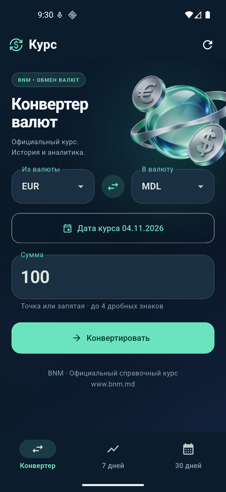

# BNM Exchange Rates for Android

**Lab 4 · Flutter / Dart · Android**

Convert MDL, EUR, USD, RON, and GBP and explore currency-pair trends over **7 and 30 days**.
This is a new Dart implementation; no C# code from Lab 3 was reused.



Version **1.1.0** introduces a dark gradient, mint accents, translucent cards,
a floating 3D currency illustration, and animated results and charts.
The app respects the system's reduced-motion setting. The illustration was generated
with AI; its [tool, file, and complete prompt](docs/ASSETS.md) are documented.

The documentation is in English. The Android interface and original device
captures are in Russian.

## Features

| Screen | Features |
| --- | --- |
| Converter | Amount entry, currency swap, date selection, exact result, publication date, and retrieval time |
| 7 days | Weekly chart, minimum, maximum, mean, absolute/percentage change, and trend |
| 30 days | Monthly analytics available as soon as historical data has loaded |
| Offline | Persistent cache across restarts, visible dates, and a clearly marked saved-data mode |

Data comes from the [official BNM XML feed](https://www.bnm.md/en/official_exchange_rates?get_xml=1&date=28.10.2026); no API key is required.
Historical data is requested for each date. When some days are unavailable,
the app shows coverage and leaves gaps instead of inventing values.
Rates are for reference. Monetary calculations use exact rational numbers backed by BigInt.

## Run in VS Code

Install the Flutter/Dart extensions, Flutter SDK, and Android SDK. Open the
project folder, then run these commands in a PowerShell terminal:

```powershell
# Run from the repository root.
flutter pub get
flutter devices
flutter run -d emulator-5554
```

If the emulator is not running yet:

```powershell
flutter emulators
flutter emulators --launch Pixel_5
```

`Pixel_5` and `emulator-5554` identify the local emulator used for validation.
On another machine, use the values reported by `flutter emulators` and `flutter devices`.
For a physical phone, enable USB debugging and use its ID from `flutter devices`.
In VS Code, you can also select an Android device in the status bar and press **F5**.

## APK

**Install on a physical phone:** copy the APK to the Android Downloads folder,
open it with the file manager, and tap Install. For detailed steps, USB debugging,
and VS Code instructions, see the [phone setup guide](docs/PHONE_SETUP.md).
Android 7.0 / API 24 or later is required.

The validated release APK is generated at `artifacts/CurrencyInsights-Android.apk`.
To build it from source:

```powershell
.\scripts\build-apk.ps1
```

The script builds in a temporary directory with an ASCII path and copies the APK
back to `artifacts` without moving the source files. This is needed for Flutter
3.47.6 on Windows: its AOT compiler cannot read project paths containing Cyrillic characters.
For a project path without Cyrillic characters, the standard
`flutter build apk --release` command also works.
The `artifacts` directory is not committed. The file size, SHA256, and build time
are saved locally in `artifacts/build-info.json`. The APK uses the generated
Android project's debug signing key for this lab.

To install on a connected Android device:

```powershell
adb install -r .\artifacts\CurrencyInsights-Android.apk
```

## Validation

```powershell
flutter test
dart analyze
```

**80/80 tests passed, with no skips. The analyzer reported no issues.**
Unit tests do not contact BNM. Seven widget tests exercise the UI at 390×844,
including form interaction while the background moves and stopping animations
when the system preference changes. The updated APK was checked on an Android
emulator: [UI version 1.1 validation](docs/UI_VALIDATION.md). The original cache,
airplane-mode, and restart checks are preserved in the
[version 1.0 validation report](docs/ANDROID_VALIDATION.md).

In the installed Flutter 3.47.6 SDK, `flutter analyze` crashes when the path
contains Cyrillic characters ([known issue](https://github.com/flutter/flutter/issues/191309));
use `dart analyze`. Validation errors are not suppressed.

## Cache and analytics rules

Data is stored in Android DataStore through SharedPreferencesAsync under the key
`bnm_cache_v1`. The cache retains up to 120 request dates, a JSON schema version,
actual publications, and retrieval timestamps. Restarting the app preserves the
cache; uninstalling the app or clearing its data removes it.

The mean uses available observations. Change is the last value minus the first;
percentage change is change / first value × 100. An empty series has no statistics,
and a single point has zero change. Each period includes the end date and the
preceding 6 or 29 days. The default date is the Android device's calendar date;
future dates are rejected.

## Project structure and lab presentation

```text
lib/domain/       exact numbers, validation, models, statistics
lib/data/         BNM XML/HTTP, persistent cache, historical data
lib/ui/           three screens and chart
assets/           generated transparent illustration
android/          the only target platform
test/             unit and widget tests
scripts/          Android APK build script
docs/             requirements and observed results
REPORT.md         report on AI use, fixes, and the language change
```

- [Report](REPORT.md), [requirements](docs/REQUIREMENTS.md), [Android validation](docs/ANDROID_VALIDATION.md), and [phone setup](docs/PHONE_SETUP.md).
- [Implementation PR #1](https://github.com/sam4ch/bnm-currency-converter-android/pull/1) and [test PR #2](https://github.com/sam4ch/bnm-currency-converter-android/pull/2).
- Generation and review were performed with Codex in this chat. The exact model name selected in the UI was not recorded.
- Validated with Flutter 3.47.6 / Dart 3.13.5, Pixel 5 AVD, and Android 16 / API 36.

Run the working app during the lab presentation; screenshots alone are not sufficient.
