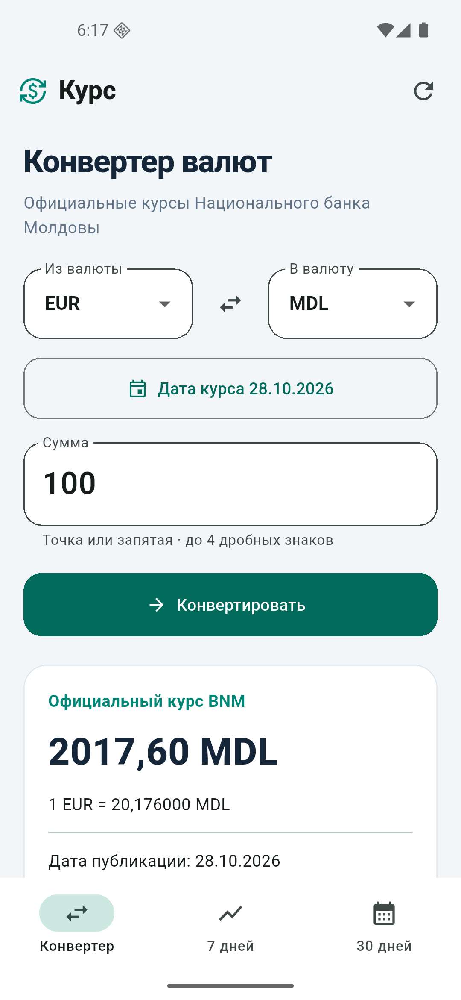

# Курс BNM для Android

**Лабораторная 4 · Flutter / Dart · Android**

Конвертер MDL, EUR, USD, RON и GBP с аналитикой валютной пары за **7 и 30 дней**.
Новая реализация на Dart: код третьей лабораторной на C# не использовался.



## Возможности

| Экран | Возможности |
| --- | --- |
| Конвертер | Сумма, смена валют, дата, точный результат, дата публикации и время получения |
| 7 дней | Недельный график, минимум, максимум, среднее, абсолютное/процентное изменение и тенденция |
| 30 дней | Месячная аналитика, доступная сразу после загрузки истории |
| Без сети | Постоянный кэш после перезапуска, видимые даты и режим сохранённых данных |

Источник — [официальный BNM XML](https://www.bnm.md/en/official_exchange_rates?get_xml=1&date=28.10.2026), API-ключ не нужен.
История загружается по датам. Если данные доступны не за все дни, показано
покрытие; пропуски не заполняются вымышленными значениями.
Курс справочный. Денежная арифметика — точные рациональные числа BigInt.

## Запуск в VS Code

Установите Flutter/Dart extensions, Flutter SDK и Android SDK. Откройте папку
проекта, затем терминал PowerShell:

```powershell
Set-Location -LiteralPath 'C:\Downloads\Study\4 курс\PSI\lab4'
flutter pub get
flutter devices
flutter run -d emulator-5554
```

Если эмулятор ещё не запущен:

```powershell
flutter emulators
flutter emulators --launch Pixel_5
```

Здесь `Pixel_5` и `emulator-5554` — имена проверенного локального эмулятора.
На другом компьютере используйте значения из `flutter emulators`/`flutter devices`.
Для телефона включите отладку по USB и используйте его ID из `flutter devices`.
В VS Code можно выбрать Android-устройство в строке состояния и нажать F5.

## APK

Проверенный release APK создаётся в `artifacts/CurrencyInsights-Android.apk`.
Собрать его из исходников:

```powershell
.\scripts\build-apk.ps1
```

Скрипт собирает во временном каталоге с латинским путём и возвращает APK в
`artifacts`, не перемещая исходники. Это нужно для Flutter 3.47.6 на Windows:
AOT-компилятор не читает кириллический путь `4 курс`. Для пути без кириллицы
также работает обычная команда `flutter build apk --release`.
Каталог `artifacts` не коммитится; размер, SHA256 и время сборки сохраняются
локально в `artifacts/build-info.json`. APK подписан учебным debug-ключом
сгенерированного Android-проекта.

Установка на подключённое Android-устройство:

```powershell
adb install -r .\artifacts\CurrencyInsights-Android.apk
```

## Проверки

```powershell
flutter test
dart analyze
```

**78/78 тестов прошли, 0 пропусков. Анализатор не нашёл замечаний.**
Unit-тесты не обращаются к BNM. Пять widget-тестов проверяют интерфейс при
размере 390×844. Реальная Android-проверка, включая режим полёта и перезапуск,
описана в [протоколе](docs/ANDROID_VALIDATION.md).

В установленном Flutter 3.47.6 команда `flutter analyze` падает на кириллице
в пути ([известная проблема](https://github.com/flutter/flutter/issues/191309));
используйте `dart analyze`. Ошибки проверок не подавляются.

## Кэш и правила аналитики

Данные хранятся во внутреннем Android DataStore через SharedPreferencesAsync,
ключ `bnm_cache_v1`. Сохраняются до 120 дат запросов, версия JSON, реальные
публикации и время получения. Перезапуск приложения кэш не удаляет;
удаление приложения или очистка его данных удаляет кэш.

Среднее считается по доступным наблюдениям. Изменение — от первого к
последнему значению; процент — изменение / первое значение × 100. Пустой
набор не имеет статистики, одна точка имеет нулевое изменение. Включены
конечная дата и 6/29 предыдущих дней. Дата по умолчанию — календарная дата
Android-устройства; будущая дата запрещена.

## Структура и материалы для защиты

```text
lib/domain/       точные числа, валидация, модели, статистика
lib/data/         BNM XML/HTTP, постоянный кэш, история
lib/ui/           три экрана и график
android/          единственная целевая платформа
test/             unit и widget тесты
scripts/          сборка Android APK
docs/             требования и реальные результаты
REPORT.md         отчёт об ИИ, ошибках и смене языка
```

- [Отчёт](REPORT.md), [требования](docs/REQUIREMENTS.md), [Android-проверка](docs/ANDROID_VALIDATION.md).
- [PR реализации №1](https://github.com/sam4ch/CurrencyConverter-Mobile-Lab4/pull/1) и [PR тестов №2](https://github.com/sam4ch/CurrencyConverter-Mobile-Lab4/pull/2).
- Генерация и ревью — Codex в текущем чате. Точное имя модели в UI не фиксировалось.
- Проверено: Flutter 3.47.6 / Dart 3.13.5, Pixel 5 AVD, Android 16 API 36.

На защите нужно запустить приложение: скриншотов недостаточно.
