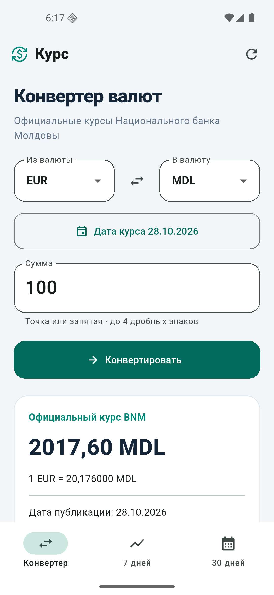
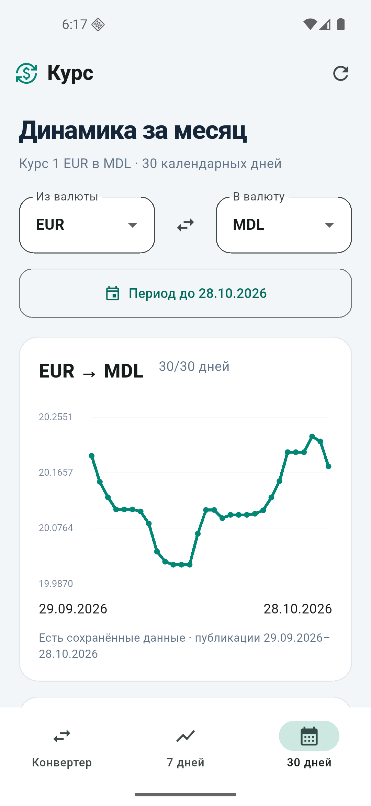
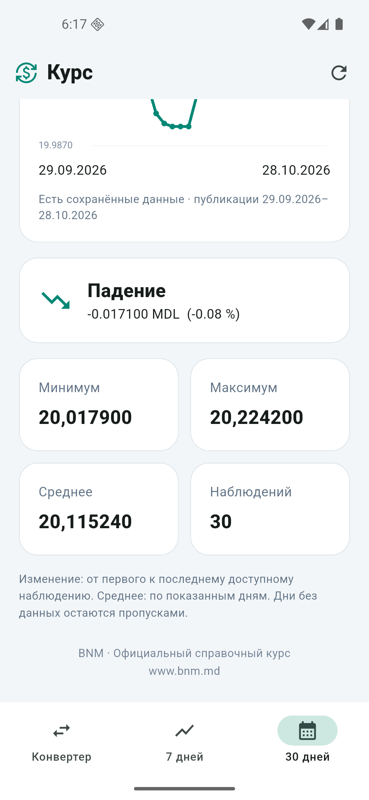
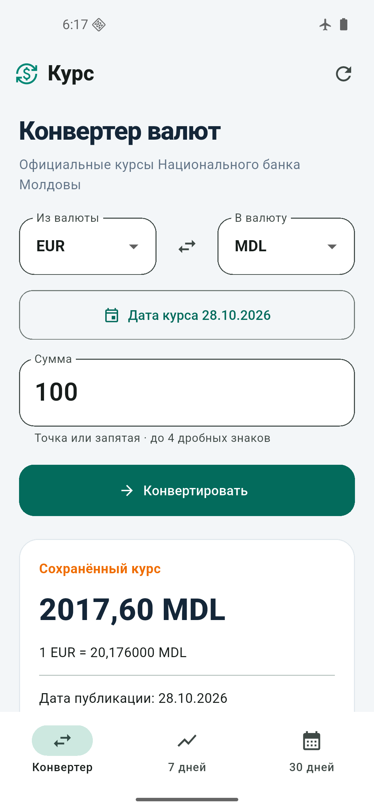

# Android validation — October 28, 2026

Device: Pixel 5 AVD, Android 16 API 36, emulator-5554. The final **release APK**
was installed and launched on Android. Checks used Android SDK ADB and
UI Automator; actual screenshots were inspected visually.
Testing on a physical phone and a demonstration to the instructor were not performed.

## Results

| Scenario | Observed result |
| --- | --- |
| Live BNM request | 100 EUR → 2017.60 MDL; publication date 28.10.2026 |
| Month | 30/30 points for 29.09–28.10.2026; chart of actual exchange rates |
| Monthly statistics | min 20.017900, max 20.224200, mean 20.115240; change −0.017100 MDL / −0.08 %; falling trend |
| Week and navigation | 7/7 points for 22–28.10.2026; +0.023700 MDL / +0.12 %; rising trend; switching tabs returns to the top of the screen |
| Airplane mode and restart | After force-stop and relaunch: cached rate of 2017.60 MDL, with the date 28.10.2026 visible |
| Offline month after restart | All 30 saved points restored in a new app process |
| Offline week after restart | All 7 points available from the persistent cache |
| Network recovery | The official BNM rate was fetched again after connectivity returned |

Airplane mode was enabled **only on the test Android emulator**; its Wi-Fi
and mobile data were also disabled. The emulator's original network state
was restored in `finally`. Windows networking was not changed.

Structured results: [android-results.json](android-results.json).
Original local UI XML dumps and PNG captures: `.tools/android-qa/` (not committed).

## Automated checks

`flutter test`: **78/78**, 0 failures and 0 skips. Machine-readable log:
`.tools/test-results.jsonl`. Unit tests do not call the live BNM service:
HTTP, the data source, and storage are replaced with test doubles.
Widget tests run at 390×844 and check validation, conversion, an exact
same-currency result without a source request, tabs and scrolling,
loading state, and empty history.

`dart analyze`: **No issues found**.

## APK

Local file: `artifacts/CurrencyInsights-Android.apk`.
The release build was produced by `scripts/build-apk.ps1` and signed with
the standard Android project's debug key for this lab.

SHA256:

```text
B45EA54DC1E6A2123CBC7CBADF9F02A55544CFA7B09B2B0D1032ADBCBA45D630
```

## Screenshots






During the lab presentation, show the running application and repeat the
airplane-mode scenario. These materials document the completed checks
and do not replace a live demonstration.
