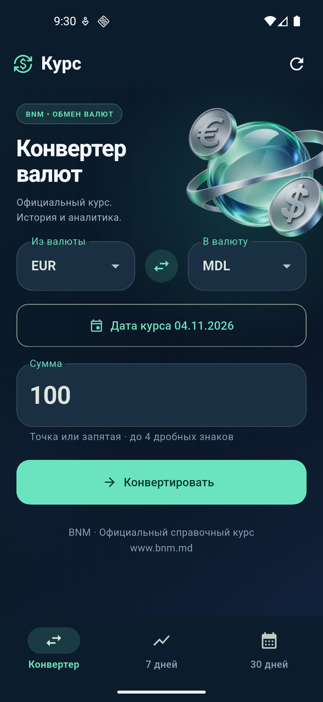
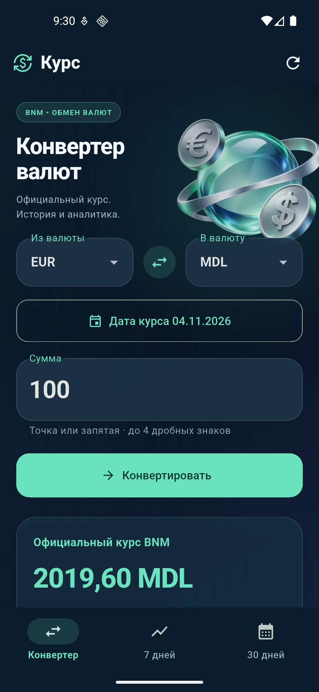
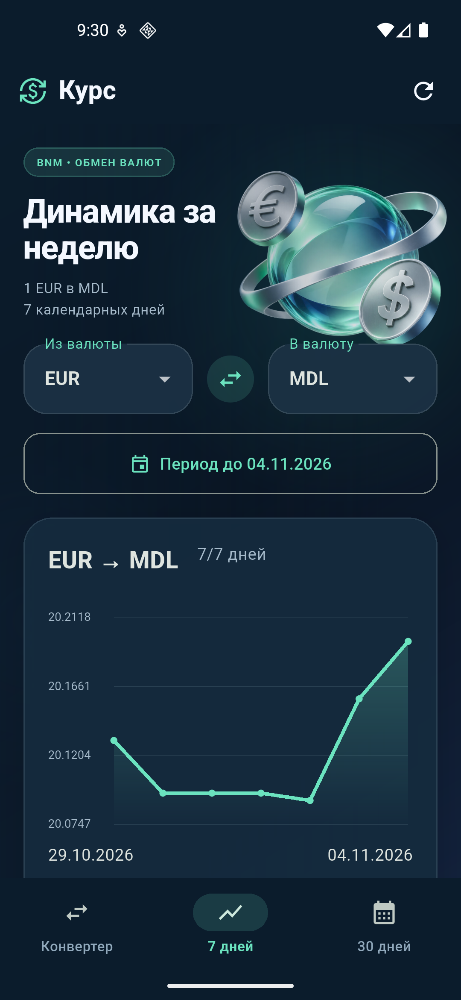
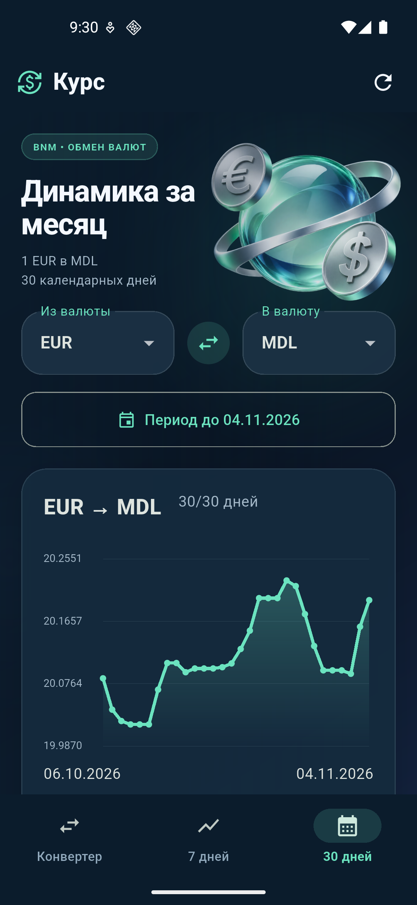
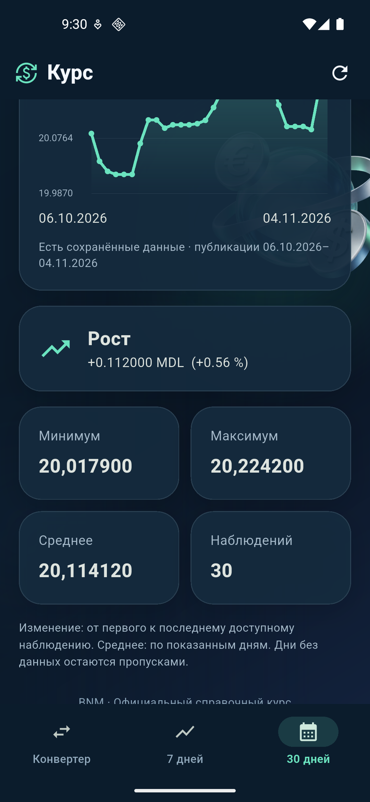
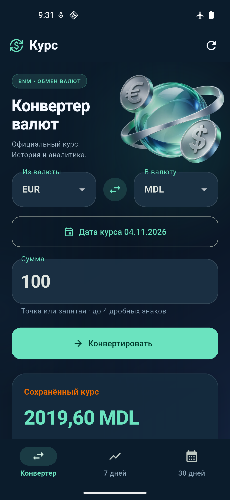

# UI version 1.1 validation — November 4, 2026

Environment: Flutter 3.47.6 / Dart 3.13.5, Pixel 5 AVD, Android 16 / API 36,
`emulator-5554`. Release APK version `1.1.0+2` was built and installed.
A physical phone was not connected or tested.

## Checks performed

- `dart analyze`: **No issues found**.
- `flutter test --no-pub --machine`: **80 passing tests**, with no failures or skips; local log: `.tools/ui-test-results.jsonl`.
- New widget tests verify that the decorative background changes position while the form still converts an amount; enabling the system reduced-motion setting stops movement and continuous frame scheduling.
- The PNG is included in the release APK through `pubspec.yaml` and `scripts/build-apk.ps1`.
- Installation over the previous APK using `adb install -r` succeeded.
- Screenshots of all three screens and the statistics were captured through ADB and inspected visually: the heading is readable, the chart and labels have clear contrast, and content scrolls.

| Android scenario | Observed result |
| --- | --- |
| Live BNM request | 100 EUR → 2019,60 MDL; publication date 04.11.2026 |
| Week | 7/7 observations for 29.10–04.11.2026 |
| Month | 30/30 observations for 06.10–04.11.2026; chart displayed |
| Monthly statistics | min 20,017900; max 20,224200; mean 20,114120; +0,112000 MDL / +0,56 %; rising trend |
| Offline after stopping the process | In airplane mode, with Wi-Fi and mobile data disabled, the cached rate was restored after force-stop: 2019,60 MDL |
| Network recovery | A new request displayed the official BNM rate again |

Network settings were changed only on the test emulator; the original
airplane-mode, Wi-Fi, and mobile-data states were restored in `finally`.
Some history uses previously saved official publications, as explicitly
indicated in the UI. Complete observed screen labels:
[ui-v2-results.json](ui-v2-results.json).
Original PNG/XML captures are stored locally in `.tools/android-qa/`.

## Build

Command: `scripts/build-apk.ps1 -Flutter C:\Users\SamirPula\flutter\bin\flutter.bat`.
APK: `artifacts/CurrencyInsights-Android.apk`, 55 878 740 bytes.
Signed with a debug key for this lab. SHA256:

```text
396F5B1A82E63C32DCB602FA67DD48443A5B2C3683DE256646C19D62A99F1E17
```

## Screenshots








APK installation and VS Code launch instructions: [PHONE_SETUP.md](PHONE_SETUP.md).
The original version 1.0 validation log is preserved separately:
[ANDROID_VALIDATION.md](ANDROID_VALIDATION.md).
